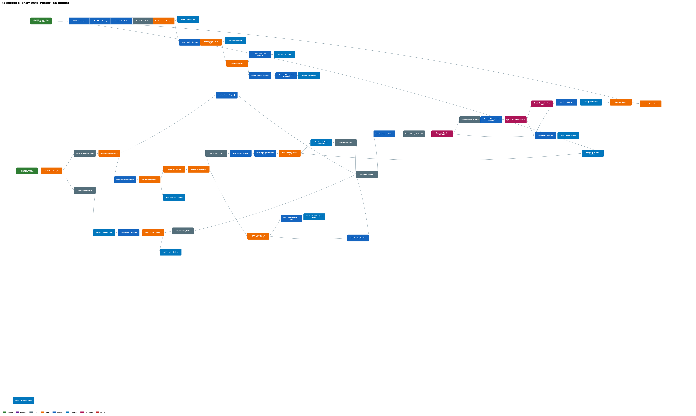
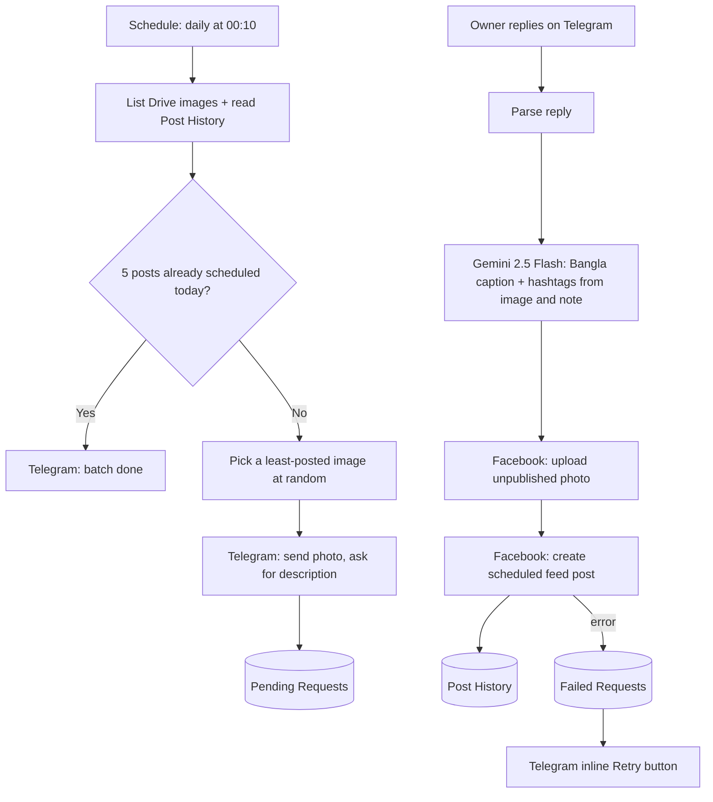

# Facebook Nightly Auto-Poster

An n8n workflow that turns a Google Drive folder of product photos into **five scheduled Facebook Page posts every night**. The shop owner only answers a short Telegram message per product; Gemini writes the Bangla caption and hashtags, the workflow schedules the post through the Facebook Graph API and records everything in Google Sheets.

**Stack:** n8n · Telegram Bot · Google Drive · Gemini 2.5 Flash (vision) · Facebook Graph API v21 · Google Sheets
**Size:** 58 nodes · runs unattended after the owner's Telegram replies

## How it works

1. **Daily batch** — a Schedule Trigger starts the batch at 00:10. The workflow reads Drive images, `Post History` and `Batch State`.
2. **Five slots** — posts are scheduled at hourly offsets from the batch start time (0, 60, 120, 180 and 240 minutes). When five are done, it sends a "batch done" message.
3. **Smart picking** — it picks at random among the images posted the fewest times, so photos rotate before any repeats.
4. **Human in the loop** — Telegram shows the photo and asks for a short description (price, features, offer). A row in `Pending Requests` tracks the wait, and a reminder nudge goes out if there is no answer.
5. **Start time** — if no start time is saved for the night, the bot asks for one on Telegram and stores it in `Batch State`. A late reply after 8 PM on the first slot triggers its own start-time question.
6. **Caption** — Gemini 2.5 Flash reads the image and the description and returns JSON with a Bangla caption and hashtags. A fallback caption is used if parsing fails.
7. **Publish** — the image is uploaded as an unpublished photo, then a feed post with `scheduled_publish_time` and `attached_media` is created.
8. **Log** — every post is written to `Post History`.
9. **Recover** — failures are saved to `Failed Requests` and the owner gets a Telegram message with an inline **Retry** button.
10. **Re-post** — sending a Drive link plus a new instruction on Telegram re-posts an existing photo with a fresh caption (`repost` mode).

## Google Sheet

Import [`templates/content_calendar_template.xlsx`](templates/content_calendar_template.xlsx) into Google Sheets.

| Tab | Purpose |
|---|---|
| Post History | One row per scheduled post: image, description used, caption, hashtags, `fb_post_id`, `scheduled_for` |
| Pending Requests | Images waiting for a description (`awaiting_description` → `resolved`) |
| Failed Requests | Retry queue with the error reason |
| Batch State | Base time per day used for slot scheduling |

## Setup

1. Import `workflow/Facebook Nightly Auto Poster.json` (it imports **inactive**).
2. Create credentials: Telegram bot, Google Drive, Google Sheets, a Gemini API key (HTTP Header Auth), and a Facebook Page access token (HTTP Query Auth, `access_token`).
3. Replace `YOUR_PAGE_ID` in the two Graph API URLs, `YOUR_TELEGRAM_CHAT_ID` in the Telegram nodes, and the Drive folder and Sheet in the Drive/Sheets nodes.
4. In the Gemini prompt node, replace `Your Shop` with your brand and adjust the caption format and hashtags.
5. Activate the workflow and send a test photo through the Telegram conversation.

## Notes and limitations

- The page access token needs page-posting permission and Facebook limits how far ahead posts can be scheduled; an invalid `scheduled_publish_time` lands in `Failed Requests`.
- The node label says "12:05 AM" while the Schedule Trigger is set to 00:10; align them to your liking.
- The "Notify – Schedule Failed" node is disabled; failures are reported through the retry message instead.
- No tokens, chat IDs, sheet IDs or brand names are stored in this repository.

## License

MIT
